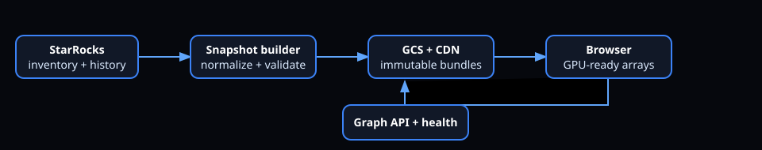

# Network Atlas v3

Network Atlas v3 is a functioning, dependency-light prototype for exploring a telecom dependency graph. It combines a searchable synthetic Core/Transport/RAN network, a rotating constellation, a structured left-to-right topology, typed directed relationships, bounded expansion, binary snapshot bundles, a graph API, and synthetic live health.



## Run it

Requirements: Node.js 20 or newer. No package download or cloud account is required.

```bash
npm run generate
npm test
npm start
```

Open [http://localhost:8000](http://localhost:8000). Search for `ATL-AGG-003`, `UPF`, `GNB-009`, or `CELL`. Switch between **Constellation** and **Left → Right**. Select an element, expand upstream or downstream dependencies, toggle relationship types, zoom with the wheel, and drag the constellation to rotate it.

The checked-in synthetic snapshot is ready to run. `npm run generate` deterministically rebuilds it. Set `PORT=9000` to use another port.

## What is implemented

- 249 deterministic synthetic elements across ATL, BOS, and DEN: AMF, SMF, UPF, PE, aggregation routers, gNBs, and cells.
- 327 physical, control-plane, carrying, dependency, and backup relationships. Directed semantics are preserved; physical links are bidirectional.
- Canvas-rendered constellation and layer-constrained Core → Transport → RAN view.
- Search, selection, typed-edge filters, upstream/downstream expansion up to six UI hops, and details/health panels.
- Graph API for status, node search/detail, filtered neighborhoods, directed shortest paths, faults, health snapshots, and SSE health updates.
- Immutable, versioned little-endian binary files for node render attributes, positions, edges, and forward/reverse CSR adjacency, plus JSON metadata and a checksummed manifest.
- A GCS-shaped `current.json` pointer and immutable version directory; the local server exposes the same relative URL model.
- Deterministic fault fixtures plus a changing synthetic fault over SSE.
- Unit, bundle integrity, and live HTTP integration tests.
- Documentation for architecture, data model, formats, API, StarRocks, GCS, visualization, performance, security, and roadmap.

## What is planned, not claimed

The prototype does **not** yet connect to a real StarRocks cluster or GCS bucket, authenticate users, render millions of elements, use WebGL, persist live telemetry, implement geographic tiles, or provide production-grade HA/observability. Those integrations and acceptance gates are specified in [Implementation roadmap](docs/IMPLEMENTATION_ROADMAP.md).

## Repository map

| Path | Purpose |
|---|---|
| `public/` | Browser UI and GCS-style public bundles |
| `server.js` | Static server, graph API, SSE health stream |
| `src/graph.js` | Indexing, search, traversal, shortest path |
| `scripts/generate-data.js` | Synthetic graph and binary snapshot builder |
| `data/snapshots/` | Canonical immutable bundle |
| `data/state/` | Synthetic health fixture |
| `tests/` | Unit, integrity, and HTTP tests |
| `docs/` | Engineering specifications and roadmap |

## Architecture at a glance

Production topology is extracted from StarRocks by a snapshot builder. It normalizes stable IDs and typed edges, computes positions and adjacency, validates checksums, uploads an immutable version to GCS, then atomically changes `current.json`. Browsers fetch rendering arrays from GCS/CDN while a memory-resident Graph API loads the same snapshot for traversal. Fast-changing health is a separate stream; historical investigation remains in StarRocks.

This separation avoids rebuilding topology when a KPI changes and avoids querying the warehouse on every interaction. See [Architecture](docs/ARCHITECTURE.md).

## Binary contract

Every binary begins with a 16-byte header. `manifest.json` declares counts, formats, byte lengths, SHA-256 values, code tables, and endianness. Dense zero-based indexes are internal to one immutable version; external APIs always use stable string IDs. Full details and compatibility rules are in [Binary format](docs/BINARY_FORMAT.md).

## API examples

```bash
curl 'http://localhost:8000/api/nodes?query=ATL-AGG&limit=5'
curl 'http://localhost:8000/api/neighborhood/ATL-AMF-01?hops=2&direction=downstream'
curl 'http://localhost:8000/api/path?from=ATL-AMF-01&to=ATL-GNB-001-C1'
curl -N 'http://localhost:8000/api/health/stream'
```

See [API](docs/API.md) for endpoint and error contracts.

## Verification

`npm test` uses Node's built-in test runner and starts the server on an ephemeral local port. Tests check traversal direction, relationship filters, paths, searches, every bundle checksum and header, referential integrity, static serving, and public API behavior. `npm run verify` regenerates the snapshot before running all tests.

## Engineering documents

- [Architecture](docs/ARCHITECTURE.md)
- [Data model](docs/DATA_MODEL.md)
- [Binary format](docs/BINARY_FORMAT.md)
- [Graph API](docs/API.md)
- [StarRocks ingestion](docs/STARROCKS_INGESTION.md)
- [GCS serving](docs/GCS_SERVING.md)
- [Visualization](docs/VISUALIZATION.md)
- [Performance](docs/PERFORMANCE.md)
- [Security](docs/SECURITY.md)
- [Implementation roadmap](docs/IMPLEMENTATION_ROADMAP.md)

## License

Prototype code and synthetic data are original to this package. No Marble source or taxonomy data is included. Add the organization-approved license before public distribution.
